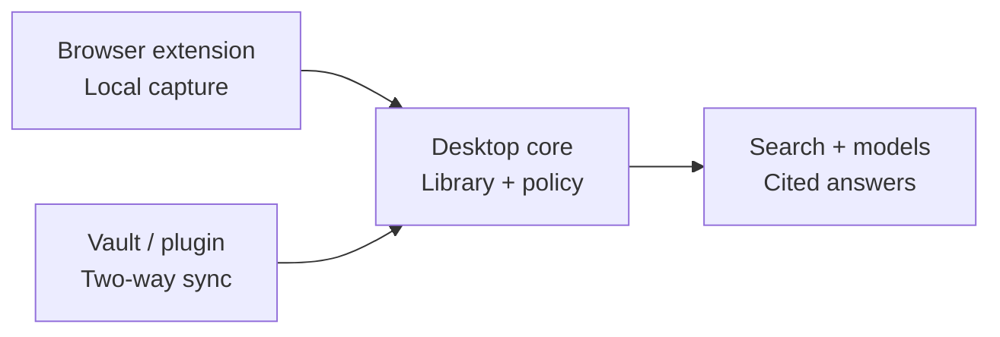
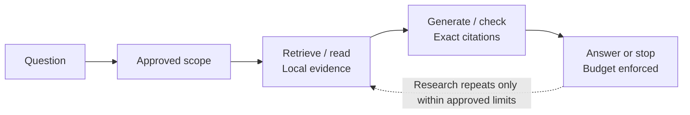

# Citspark: Product & Engineering Specification

> Preserve sources. Retrieve evidence. Learn with traceable answers.

**Version 1.0** | 16 November 2026 | Product owner: Shaan Gill | 61 approved interview decisions

Approved product baseline. Implementation choices and numerical targets remain explicitly labeled where feasibility validation is required.

> This Markdown document is the authoritative in-repo copy of the specification: a faithful transcription of the owner-approved v1.0 PDF, which the owner retains. The owner resolves any discrepancy and records it through an ADR or a spec revision. Requirement IDs are tracked in [traceability.md](traceability.md).

## Contents

1. [Authority and release contract](#1-authority-and-release-contract)
2. [Scope and boundaries](#2-scope-and-boundaries)
3. [User journeys and interfaces](#3-user-journeys-and-interfaces)
4. [System architecture and trust boundaries](#4-system-architecture-and-trust-boundaries)
5. [Capture and recovery requirements](#5-capture-and-recovery-requirements)
6. [Linked sources and media](#6-linked-sources-and-media)
7. [Canonical data contracts](#7-canonical-data-contracts)
8. [Obsidian synchronization and plugin](#8-obsidian-synchronization-and-plugin)
9. [Search, organization, and graph](#9-search-organization-and-graph)
10. [Answers and bounded research](#10-answers-and-bounded-research)
11. [Privacy and security](#11-privacy-and-security)
12. [Storage, trash, backup, and migration](#12-storage-trash-backup-and-migration)
13. [Accessibility and language](#13-accessibility-and-language)
14. [Engineering contracts and feasibility gates](#14-engineering-contracts-and-feasibility-gates)
15. [Acceptance tests and quality gates](#15-acceptance-tests-and-quality-gates)
16. [Delivery and open-source release](#16-delivery-and-open-source-release)
17. [Decision ledger: Q1-Q61](#17-decision-ledger-q1-q61)
18. [Glossary and completion checklist](#18-glossary-and-completion-checklist)

## 1. Authority and release contract

This specification consolidates the owner's interview decisions. It supersedes conflicting proposals in the earlier Threadmark PRD. It is a specification, not a claim that the product is implemented or tested. MUST identifies an approved obligation. PROPOSED identifies an implementation default or measurable target that still needs validation. Architecture choices remain subject to bounded feasibility tests. No scope reduction is authorized by those tests.

The first complete release MUST deliver preservation, retrieval, and source-grounded learning together. It MUST include two-way Obsidian integration, an optional companion plugin, local and cloud answers, and bounded agentic research. Partial builds may ship as clearly labeled alpha or beta previews. Version 1.0 MUST wait until every required capability passes its acceptance gates. Scope changes require owner approval.

The audience includes people without Obsidian and without developer tools. Normal installation MUST not require Python, Docker, or terminal commands. An account with Citspark is not required.

The prose uses controlled, direct English where practical. This document does not claim certified ASD-STE100 or PDF accessibility conformance.

## 2. Scope and boundaries

Launch includes macOS, Windows, and Linux desktop applications; Chrome and Edge capture; one X account; bookmarks, folders, and likes; manual and opt-in scheduled capture; direct linked posts and articles; original-author thread continuations; media preservation; opt-in local OCR and audio/video transcription; local search; fixed and agentic RAG; protected vault synchronization; graph and list navigation; migration; backups; and accessibility.

Learning means cited chat, comparisons, explanations, and saved research notes. Learning paths, quizzes, spaced repetition, and competence tracking are deferred.

Deferred capabilities include independent mobile AI, browser-history import, Firefox and Safari capture, multiple X accounts, automatic multi-computer library sync, autonomous live-web research, visual interpretation of charts or video frames, and write-back to X.

Mobile users may read and edit notes through their existing vault synchronization service. Citspark processes changes when they reach the desktop. The plugin research interface requires the desktop service on the same computer; mobile is not promised as an independent client.

X access MUST remain read-only. Local deletion, organization, or tags MUST NOT change X bookmarks, likes, posts, or folders.

## 3. User journeys and interfaces

Onboarding: choose a local library; import an archive or pair the extension; approve collection access; select an optional vault folder; preview import; begin search. AI setup is separate and optional. Show privacy boundaries before connecting providers or downloading models.

Capture: select bookmarks, folders, or likes; start; inspect committed counts and gaps; pause; resume; export partial results. Scheduled jobs run only when the desktop and authenticated browser are available. Missed schedules wait, without an unbounded catch-up burst.

Research: choose quick answer or research mode; choose the approved model; inspect evidence; cancel or extend a stopped budget explicitly; save the result as generated content. Citation activation opens the exact archived evidence with a separate live link.

Vault workflow: select managed paths and optional additional notes; preview changes; sync; review conflicting edits. Files outside the selected scope remain untouched.

Required screens: library; capture status; import preview; source and version viewer; search; cited chat; research action trace; graph and relationship list; sync/conflict review; trash; backups/restore; model management; paired clients; diagnostics.

Each screen MUST expose loading, empty, partial, failure, and recovery states. Progress percentages require a known total; otherwise display actual committed counts and elapsed time.

## 4. System architecture and trust boundaries

The desktop application owns the canonical library, synchronization, retrieval, privacy enforcement, model execution, and job coordinator. The extension captures browser-authorized content. The optional Obsidian plugin is a client of the same desktop backend, not a second synchronization engine.

*Logical components; all access passes desktop authorization.*

The library and indexes remain local. Cloud generation receives only the user question and selected authorized evidence plus minimal citation metadata and required conversational context. Conversation context MUST undergo the same privacy filtering; prior local-only answers cannot leak through chat history. Source documents are untrusted data, never instructions.

The extension and plugin MUST pair explicitly, receive separate revocable credentials, and use limited permissions. Same-computer transport only is supported at launch. Localhost alone is not authentication. Verify client identity, origin/host where applicable, request schema, permissions, and protocol versions. Paired extension permissions cover capture ingestion and its job state. Plugin permissions cover approved search, research, and sync controls. Neither client receives arbitrary filesystem access or application command execution.

Block incompatible operations before mutation. Explain the component that needs updating. Keep unaffected features working. Publish and test a compatibility matrix.

## 5. Capture and recovery requirements

**CAP-01**: Capture structured collection data through replaceable, versioned adapters. Prefer an audited existing collector over custom code when adequate. Evaluate xarchive and twitter-web-exporter; inspect licenses, dependencies, credentials, network behavior, and fixtures before reuse. Earlier research is not current maintenance proof.

**CAP-02**: Treat platform IDs as strings. Bind collection membership to account identity and collection identity. Detect an account switch and pause before merging data.

**CAP-03**: Commit records and continuation cursor atomically. Advance only after persistence. Replaying a committed page MUST be idempotent. Use a lease to prevent overlapping capture owners for the same collection.

**CAP-04**: Support pause, resume, cancel, authentication-required, rate-limited, partial, failed, and complete outcomes. Cancel stops new work and preserves committed records. Detect cursor loops, malformed payloads, unsupported schemas, and disk exhaustion.

**CAP-05**: Respect Retry-After and platform rate limits. Use bounded backoff for transient failures. Never bypass authentication or restrictions. Do not retry explicit unavailability in a tight loop.

**CAP-06**: Complete means a recognized end for that scan, not recovery of inaccessible or historical content. Record committed pages, distinct IDs, gaps, adapter version, and exact termination evidence.

**CAP-07**: If X changes, pause capture honestly. Saved library, search, and AI remain available. Supported imports remain usable. An official API fallback is not a launch dependency.

**CAP-08**: Original-author thread continuations MUST preserve individual post identities, order, and citations. Exclude unrelated replies by default. Uncertain thread membership or missing continuations MUST be flagged. The adapter must prove relationship evidence rather than infer membership solely from author identity.

**CAP-09**: Preserve original-language text and available translation observations separately. Do not substitute a rendered translation for an author-original quotation without labeling it.

## 6. Linked sources and media

**ENR-01**: Capture accessible direct links to X posts and web articles as separate sources. First reuse exact saved sources or embedded snapshots. Deduplicate missing destinations. Do not recursively crawl discovered links by default. A thread continuation is part of the approved thread scope, not permission for unlimited link traversal.

**ENR-02**: Store original URL, canonical URL, redirect destination, title, observed time, extraction method, and content hash. Paywalls, restrictions, and failed extraction remain explicit gaps. Search snippets are not full article captures.

**ENR-03**: Block private-network and local-file targets in web fetchers. Revalidate redirects and resolved addresses. Enforce response size, timeout, and content-type limits. Sanitize displayed content.

**MED-01**: Preserve accessible media with content hashes, source relationships, MIME type, size, and acquisition status. Use separate resumable download jobs. File presence does not mean media was understood.

**MED-02**: Local image OCR and audio/video transcription are opt-in. Label outputs machine-generated. Store model/version, settings, language, source-media hash, and observation time. OCR cites an image and region when available; transcription cites time ranges.

**MED-03**: Keep derived text separate from original source text. Support corrections as user-authored versions, not silent edits of original media. Do not promise accurate chart interpretation, scene descriptions, or complete video comprehension.

**MED-04**: At the configured media limit, pause new media downloads without evicting existing files. Continue text only while disk safety permits. Retain resumable pending entries. Actual disk exhaustion pauses all writes safely.

**MED-05**: Processing concurrency and memory MUST be bounded. Show model downloads, storage requirements, and resource use. No automatic model downloads during a query.

## 7. Canonical data contracts

- **source**: stable namespaced ID, source type, canonical URL, author identity where known.
- **source_version**: immutable content snapshot, content hash, original/translation status, completeness, publication time if known.
- **observation**: source/version reference, capture time, method, adapter version, availability and evidence.
- **collection and membership**: account-scoped identities, labels, first/last observed membership, scan provenance. Absence from a scan does not prove deletion or removal.
- **relationship**: from/to identity, type, evidence/version, captured versus inferred versus user-authored origin, approval state. Approval does not turn an inference into a verified fact.
- **annotation**: user-authored text, stable ID, base revision, edit history, source references, privacy policy.
- **media and derivation**: hashes, local blob references, OCR/transcript segments, model fingerprint, attribution and inherited privacy.
- **chunk**: version reference, exact character offsets or media segment references, text hash, document type, index generation.
- **job**: state, lease, cursor, retry metadata, progress, stop reason, cancellation, durable checkpoints.
- **sync_binding**: library ID, vault ID, stable note ID, path, last common content hash, unlink/deletion suppression state.
- **answer**: generated text, question, provider/model configuration, exact evidence references, policy scope, index generation, action trace, validation outcome.
- **privacy_policy**: local-only or provider-authorized scope with provenance propagation. Derived artifacts inherit the most restrictive input policy.
- **backup_manifest**: schema version, library identity, file hashes, optional-media inventory, encryption metadata, creation time. Credentials are excluded.

A repeated source ID merges identity while distinct snapshots and annotations survive. Identical text does not merge different X IDs. A text difference is an observed change, not automatically proof of an author edit.

## 8. Obsidian synchronization and plugin

**SYN-01**: Two-way desktop sync MUST work without the plugin. Stable IDs, common-base revisions, and managed-file hashes distinguish moves, renames, edits, and duplicates. Scope includes managed notes plus explicitly included notes/folders. Entire-vault access is opt-in.

**SYN-02**: Preserve captured originals immutably. User-edited copies and annotations sync into Citspark as separately attributed content. Retrieval and citations MUST distinguish them from author statements.

**SYN-03**: Use three-way comparison or an equivalent verified method. Automatically merge non-conflicting changes. Preserve conflicting variants for explicit review; continue unaffected notes. Ambiguous structured metadata is a conflict, not last-write-wins.

**SYN-04**: Deleting a vault note unlinks it. Preserve the archive, do not recreate the note automatically, and allow explicit restoration of its binding. Trashing a source in Citspark preserves and unlinks the vault note and suppresses re-import while trashed.

**SYN-05**: Watcher events are hints. Reconcile with disk state after restarts, missed events, partial writes, and external sync. Write atomically where supported. Avoid feedback loops using hashes and transaction identity. Never follow symlinks beyond authorized scope without explicit policy.

**SYN-06**: Markdown remains portable and readable without Citspark. Use versioned frontmatter, stable source IDs, separate source/user/generated sections, and documented escaping. Never overwrite unrelated files.

**PLG-01**: Ship an optional Obsidian companion plugin with sync status, conflict review, capture/import controls, source navigation, evidence search, cited chat, and bounded research. It uses desktop permissions, models, budgets, and citations. Capture commands require the authenticated browser; plugin availability does not bypass capture prerequisites.

**PLG-02**: Show disconnected, unpaired, incompatible, and desktop-not-running states. Do not create an independent plugin database or research policy engine.

## 9. Search, organization, and graph

**RET-01**: Provide unified search across saved posts, linked references, selected user notes, and labeled derived text. Support exact-ID lookup, keyword retrieval, and local semantic retrieval with optional reranking. Display actual retrieval mode and explicit fallback.

**RET-02**: Filter by collection, source type, author, dates, version, language, completeness, availability, and privacy. Exclude trashed sources at query time even if stale index entries remain.

**RET-03**: Return exact excerpt, version ID, offsets or segment, live URL, document type, capture limits, and index generation. Retrieve supporting context without mixing versions silently. Updates publish new index generations atomically with rollback.

**ORG-01**: Provide user-controlled collections, tags, filters, and saved searches. AI suggestions require explicit individual or batch approval. Ingestion MUST not depend on an LLM.

**GRF-01**: Ship filtered interactive graph exploration and linked-source navigation with an accessible list equivalent. Display captured, user-authored, and inferred edges distinctly. AI connections remain separate proposals until approved. Preserve their inferred status after approval.

**GRF-02**: Do not render all 100,000 posts at once. Use bounded subgraphs, pagination, relationship filters, and source-opening controls. Similarity is not a factual relationship or evidence of agreement.

## 10. Answers and bounded research

**AI-01**: Both quick cited answers and bounded agentic research MUST ship. At least one evaluated local configuration MUST support both modes on documented suitable hardware. Native OpenAI, Anthropic, and Gemini integrations plus a configurable OpenAI-compatible connector MUST ship with tested capability matrices.

**AI-02**: Evidence-only is the default. Return supported partial findings and explicit gaps. Do not fill gaps with uncited model knowledge. Present conflicting source positions with citations and distinguish publication dates from observation dates.

**AI-03**: Citations open the exact archived version at the cited passage, image, or timestamp. Include an independent live-source link and evidence-type label. A syntactically valid citation does not establish claim support.

**AI-04**: Research reads the saved library only. Permitted tools search sources, open exact versions, expand context, and inspect approved relationships. No live web fetch, filesystem mutation, executable code, account changes, or recursive agents.

**AI-05**: Enforce tool-call, elapsed-time, token, and context limits in application code. At budget exhaustion, stop, return supported findings, disclose unresolved work, and require explicit extension. Support cancellation. Cloud price estimates are labeled estimates, not guaranteed bills.

**AI-06**: Save action traces containing queries, tool actions, evidence IDs, counts, and stop reasons. Do not require hidden reasoning or chain-of-thought disclosure. Bound logs and apply privacy policies.

**AI-07**: Generated notes remain searchable but are excluded from evidence by default. Resolve their underlying sources instead. User annotations remain independently attributed. Never launder generated claims into primary evidence.

**AI-08**: Validate response schema, citation membership, exact quotes, version references, and evidence access policy. Reject unsafe or invalid output or return evidence only. Evaluate entailment and unsupported claims separately through a frozen test set and review.

**AI-09**: Jev is an optional feasibility experiment, not a launch dependency. Any remote controller obeys the same privacy and consent rules. All features work without it.

## 11. Privacy and security

**SEC-01**: Archive, embeddings, retrieval, OCR, and transcription stay local. Cloud answers require explicit approval per library and provider. No silent provider changes or cloud fallback.

**SEC-02**: Notes/folders can be local-only. Enforce this across chunks, annotations, OCR, transcripts, summaries, chat context, caches, graph descriptions, and tool responses before dispatch. Do not send protected titles or metadata as a workaround. A cloud answer can state a local policy limitation without exposing the restricted content.

**SEC-03**: If local-only evidence is needed, explain the limitation and offer an explicit local rerun. Do not offer recurring one-time upload exceptions. Privacy settings can be deliberately changed outside the answer flow.

**SEC-04**: Store provider keys and pairing credentials in OS credential facilities where available. Do not include credentials in logs, archives, exports, source fixtures, or backups. Redact diagnostics by default.

**SEC-05**: No automatic telemetry. Provide local health checks and a previewable, redacted support bundle. Sharing remains an explicit user action.

**SEC-06**: Escape HTML and Markdown rendering; neutralize CSV formulas; reject archive path traversal; enforce import quotas against archive bombs; validate media types; isolate untrusted parsing; use dependency scanning and signed/verifiable updates where supported.

**SEC-07**: Define a threat model for malicious websites, imported archives, compromised sources, prompt injection, unauthorized local clients, and accidental disclosure. A fully compromised OS is outside the application's protection guarantee.

**SEC-08**: No promise of library-at-rest encryption follows from encrypted backup support. Document reliance on host filesystem protection. Obsidian exports and existing backups remain separate copies.

## 12. Storage, trash, backup, and migration

**DAT-01**: Support 100,000 saved posts plus linked sources and media as a capacity target. Bound memory, use incremental indexing, and state separate disk/media requirements. This is not a promise of X collection access.

**DAT-02**: Core archiving, sync, and search target computers with 8 GB RAM. Local answer models and transcription have separately published requirements. Use bounded batches and adjustable concurrency. Never imply all models fit this minimum.

**DAT-03**: Citspark deletion moves a source into recoverable trash, excludes it from search/AI immediately, and suppresses automatic recapture until restoration. Emptying trash is explicit. Remove source-derived indexes and unshared blobs while preserving shared data by reference counting or equivalent validation.

**DAT-04**: Retained citations must report unavailable evidence rather than silently resolve to another source after deletion. Existing vault files and backups are not erased by local trash or purge; disclose them.

**BKP-01**: Ship manual export/restore and opt-in scheduled backups to a selected local or mounted drive. Include retention controls, integrity verification, and restore tests. Missing destinations pause backups and report failure. Same-disk backups do not protect against disk failure.

**BKP-02**: Support optional password encryption, recommended by default. Use a maintained authenticated-encryption format and reviewed password derivation; do not design custom cryptography. Lost passwords cannot be recovered. For unattended encrypted schedules, protect any retained key with OS facilities and disclose that arrangement.

**BKP-03**: Full portable backups include sources, versions, annotations, relationships, manifests, and selected media. Credential data is excluded. Clearly distinguish full and media-excluded backups. Derived indexes may be rebuilt if omitted with explicit manifest disclosure.

**MIG-01**: Import native Citspark backups, the existing owner vault, and tested xarchive export versions. Show dry-run counts, mapping, duplicates, warnings, and conflicts. Unknown provenance remains unknown. Reject unsupported schemas rather than guess.

**MIG-02**: Back up before schema or vault migration. Build candidate indexes separately; verify counts, hashes, IDs, relationships, and exact citation targets before switching. Preserve original snapshots, annotations, pending provenance exclusions, and learner-owned progress. Do not run a legacy destructive whole-vault generator.

## 13. Accessibility and language

**ACC-01**: Core workflows MUST support keyboard navigation, screen readers, visible focus, sufficient contrast, and reduced motion. Test applicable WCAG 2.2 AA criteria and native platform behavior. Cover conflict resolution, graph alternatives, pairing, citations, model setup, and recovery, not only the main screen.

**ACC-02**: Provide programmatic names, logical focus order, accessible errors, status announcements, scalable text, and non-color status distinctions. Require representative assistive-technology testing on supported platforms.

**LAN-01**: English interface and English AI-quality testing are required. Preserve Unicode in any language. Other-language understanding is best-effort. Document tokenizer limits and exact lookup alternatives. Do not advertise universal multilingual OCR, transcription, or cross-language retrieval.

## 14. Engineering contracts and feasibility gates

PROPOSED API families: imports/preview and imports/commit; capture/jobs and cancellation; sources/versions; search; answers; research; vault-sync/preview and apply; conflicts/resolve; exports; backups/restore; clients/pair and revoke; diagnostics.

Every mutation requires a versioned schema, authenticated scope, request ID, idempotency handling where applicable, bounded payloads, and structured errors. Research responses include evidence references and stop reason. Streamed events carry sequence IDs and terminal state; reconnect MUST not repeat a mutation.

PROPOSED architecture candidates: TypeScript extension and UI; Tauri or Electron desktop shell; SQLite canonical metadata and FTS; bounded vector index; packaged local worker for inference and extraction. No choice is locked merely by this proposal.

F0 is a time-boxed feasibility phase. PROPOSED deadline: ten engineering days from implementation start, then owner review of results. Record architecture decisions before production feature development. If tests fail, report a concrete blocker and revised plan; do not silently drop launch requirements.

F0 tests: capture restart with real authorized samples and synthetic fixtures; cross-platform packaging without developer tools; plugin pairing; vault rename/conflict handling; 100,000-post search on the 8 GB reference setup; local generation/tool-use model quality; OCR/transcription resource behavior; encryption and restore; license compatibility.

Reuse candidates require a pinned revision, current license inspection, dependency inventory, synthetic fixtures, and security review. Apache-2.0 applies to original code; models and dependencies retain separate terms.

## 15. Acceptance tests and quality gates

**T01** Capture replay: interrupt before, during, and after page commit. Recover all committed records with zero duplicate canonical identities or advanced-uncommitted cursors.

**T02** Coverage: cursor loops, auth failures, rate limits, unsupported schemas, disk limits, unavailable sources, and partial threads MUST never become false complete outcomes.

**T03** Attribution: root posts, quotes, user edits, translations, OCR, transcripts, and AI notes remain correctly distinguished in fixtures and citations.

**T04** Sync: test offline edits on both sides, rename, move, delete, recreate, watcher loss, external vault sync, concurrent metadata changes, and interrupted writes. No silent overwrite of user content.

**T05** Privacy: inject local-only material into source text, titles, annotations, OCR, prior chat, and derived summaries. Assert zero protected content in all mocked remote requests, traces, and diagnostics.

**T06** Pairing: unpaired, revoked, wrong-origin, wrong-scope, replayed pairing, and incompatible clients cannot mutate or retrieve unauthorized data.

**T07** Deletion: trash immediately disappears from search and AI; sync unlink and import suppression persist across restart; purge removes unshared derived data without destroying other sources.

**T08** Backup: restore encrypted and plaintext archives into a fresh installation. Verify hashes, annotations, policy scopes, relationships, and cited snapshots. Test wrong password, corruption, missing media, and unavailable backup destination.

**T09** Import: repeated native and xarchive imports remain idempotent; malicious paths and malformed records are rejected; fuller captures are not replaced by weaker imports.

**T10** AI: fixed and agentic modes pass the same held-out exact, paraphrase, multi-source, conflicting, revised, unanswerable, and injection tests. Assess citation validity separately from entailment. Unsupported configurations remain disabled; required tested configurations cannot be omitted from 1.0.

**T11** Performance: publish hardware, corpus, linked-source volume, vector model, index size, and cold versus warm timings. PROPOSED targets are p95 warm keyword search under one second and hybrid search under three seconds on the declared reference machine. Validate before making public guarantees.

**T12** Quality: PROPOSED targets are recall@10 at least 90 percent on curated answerable questions, 100 percent citation-target validity, at least 95 percent supported material claims, and at least 95 percent correct insufficient-evidence behavior. Freeze the evaluation set before tuning and obtain independent review. These thresholds are proposals, not approved measured achievements.

**T13** Accessibility: complete onboarding, import, capture pause, search, citation navigation, conflict resolution, research cancellation, and restore using keyboard and supported screen readers.

**T14** Clean install: test macOS, Windows, Linux, Chrome, Edge, and the optional Obsidian plugin across the published compatibility matrix. Each platform has a tested local AI path on suitable hardware.

**T15** End-to-end: import; capture; interrupt/resume; merge; enrich; OCR/transcribe; sync both ways; resolve conflict; search; graph navigation; answer with archived citations; respect local-only scope; stop at budget; back up; restore in a fresh installation.

Zero-loss, zero-credential-disclosure, and zero-protected-upload security tests are release blockers. Passing a finite test suite is not a universal correctness guarantee.

## 16. Delivery and open-source release

**M0** Feasibility: produce measured prototypes, a license inventory, architecture decisions, and a capability matrix. Exit requires the owner-reviewed implementation plan.

**M1** Data foundation: canonical archive, versioning, jobs, capture, import, media preservation, and recoverable storage. Preview status only.

**M2** Desktop and vault: packaged apps, pairing, two-way sync, conflicts, plugin integration controls, backups, and restore.

**M3** Knowledge layer: unified search, OCR/transcripts, organization, graph and list navigation, exact citations, and privacy filtering.

**M4** Intelligence: managed local runtime, native cloud adapters, quick answers, bounded research, plugin research UI, and frozen evaluation.

**M5** Release hardening: accessibility, full compatibility tests, migration trials, security review, docs, synthetic demo, and clean-machine acceptance. Version 1.0 requires every approved capability, not merely completion of a milestone label.

Public alpha/beta previews are allowed, but this specification is not authorization to publish private data or release software automatically. Maintain Apache-2.0 notices, third-party attribution, SECURITY.md, contribution guidance, reproducible builds, redacted diagnostics, and no private vault content in the repository.

Unresolved engineering details include CPU/OS version matrix, exact local models, runtime/framework, archive encryption format, performance fixture composition, default media budgets, and backup retention defaults. Resolve them in F0 or before their dependent milestone, record the decision, and preserve approved product constraints.

## 17. Decision ledger: Q1-Q61

The following entries record owner-approved product choices. Recommendations count as approved only where the owner selected them.

**Q01**: Preservation, retrieval, and learning are all non-negotiable in the first complete release.

**Q02**: Serve people without Obsidian; Obsidian integration ships at the same time.

**Q03**: Two-way Obsidian synchronization is required.

**Q04**: Preserve original captures separately from user edits and annotations.

**Q05**: Deleting an Obsidian note unlinks it without deleting or automatically recreating the archive item.

**Q06**: Merge non-conflicting edits; retain conflicting versions for review.

**Q07**: Default access covers managed notes and explicitly included material; whole-vault access is opt-in.

**Q08**: Desktop synchronization; mobile edits arrive through the user's existing vault sync.

**Q09**: macOS, Windows, and Linux launch together.

**Q10**: Local-first library; no Citspark account; no automatic multi-computer library sync at launch.

**Q11**: Local models and user-supplied cloud keys; no silent cloud fallback.

**Q12**: Standard RAG and bounded, read-only agentic research ship together.

**Q13**: Evidence-only answers by default; report gaps without uncited model supplementation.

**Q14**: Learning is research/chat/comparison/explanation/saved notes; structured learning is deferred.

**Q15**: Bookmarks, bookmark folders, and likes; browser history deferred. PDF creation requires explicit approval after discussion.

**Q16**: Preserve accessible direct linked X posts and articles; no recursive crawl by default.

**Q17**: Preserve accessible original-author thread continuations, order, citations, and gaps; exclude other replies by default.

**Q18**: Media preservation and opt-in local OCR/audio-video transcription are required.

**Q19**: Visual interpretation beyond text is deferred; uninspected visuals remain flagged.

**Q20**: Chromium capture with Chrome and Edge explicitly tested; Firefox and Safari deferred.

**Q21**: Manual capture plus opt-in scheduling when desktop and authenticated browser are available.

**Q22**: One X account at launch; account-aware storage supports future expansion.

**Q23**: Installable desktop application plus extension; no developer setup for normal use.

**Q24**: Optional managed local-model setup with resource checks; existing runtime and cloud options remain available.

**Q25**: Retrieval, embeddings, OCR, and transcription stay local; cloud receives selected answer context only.

**Q26**: Capacity target is 100,000 saved posts plus references/media, not guaranteed platform access.

**Q27**: Core app targets 8 GB RAM; local AI/transcription have separate requirements.

**Q28**: Pause new media at storage limits; never silently evict saved files.

**Q29**: Manual and scheduled backups with destination, retention controls, verification, and restore support.

**Q30**: Optional password-encrypted backups, recommended by default; no password recovery guarantee.

**Q31**: Pause capture if X changes; archive/search/AI remain usable; official API fallback not required.

**Q32**: English interface and evaluated English AI quality; Unicode preserved, other languages best-effort.

**Q33**: Apache-2.0 original code, subject to compatible dependencies and separate model terms.

**Q34**: Select implementation stack through bounded feasibility tests and a decision deadline.

**Q35**: Public labeled previews allowed; all requirements still gate version 1.0.

**Q36**: No automatic telemetry; local diagnostics and explicit redacted support export.

**Q37**: Existing vault and selected exporter migration with dry-run/provenance preservation.

**Q38**: xarchive is the first required third-party format, tied to tested versions.

**Q39**: Merge identical source identities; preserve versions/annotations/conflicts; do not merge different IDs by text alone.

**Q40**: X is read-only; local organization and deletion never mutate the account.

**Q41**: Show conflicting evidence with citations and dates; do not silently choose a winner.

**Q42**: Saved AI notes are searchable but excluded from answer evidence by default.

**Q43**: Citations open exact archived versions/locations and label evidence type; live link is separate.

**Q44**: Accessibility is a release requirement across core workflows.

**Q45**: User-controlled organization; AI proposals require approval and support batch review.

**Q46**: Interactive graph and linked-source navigation both ship, with bounded views and accessible alternatives.

**Q47**: AI graph edges require approval and remain identified as inferences.

**Q48**: Research uses saved library only; capture/import supplies new sources separately.

**Q49**: Stop at research budgets; return partial findings and require explicit continuation.

**Q50**: Recoverable Citspark trash, immediate retrieval exclusion, recapture suppression, explicit purge.

**Q51**: Trashing in Citspark preserves/unlinks vault notes and suppresses re-import; disclose separate copies.

**Q52**: Plugin-free sync is required AND an optional companion plugin ships at launch.

**Q53**: Plugin includes integration controls and in-vault search, cited chat, and bounded research through desktop.

**Q54**: Same-computer explicit pairing, separate revocable credentials, limited client permissions.

**Q55**: Compatibility checks block unsafe operations; backups precede migrations; unaffected features remain available.

**Q56**: Cloud approval per library/provider with local-only notes/folders and derived-policy inheritance.

**Q57**: Enforce local-only boundaries without one-time upload exceptions; offer explicit local rerun.

**Q58**: Native OpenAI, Anthropic, Gemini, and configurable OpenAI-compatible connector with tested capabilities.

**Q59**: Jev is optional experimentation, not a dependency.

**Q60**: At least one tested local configuration supports both answers and agentic research.

**Q61**: Hold version 1.0 until all required capabilities pass; scope changes need owner approval.

## 18. Glossary and completion checklist

- **RAG**: retrieval supplies selected evidence to a generative model.
- **Agentic RAG**: a model chooses bounded read-only evidence actions under application-enforced limits.
- **Hybrid retrieval**: keyword and semantic search combined.
- **OCR**: machine extraction of text from images.
- **Observation**: a captured state at a known time, not proof of full history.
- **Inference**: a proposed interpretation, not original evidence.

Before implementation: confirm F0 owners, deadline, reference hardware, and fixture rights. Before beta: demonstrate recoverability, privacy enforcement, and clean installation. Before 1.0: pass T01-T15, resolve all required compatibility paths, publish limitations, and obtain owner acceptance of the complete scope. This document authorizes no deployment, publication, account changes, paid subscriptions, or external upload of the private source collection. It defines the product to implement and the evidence needed to call it complete.
